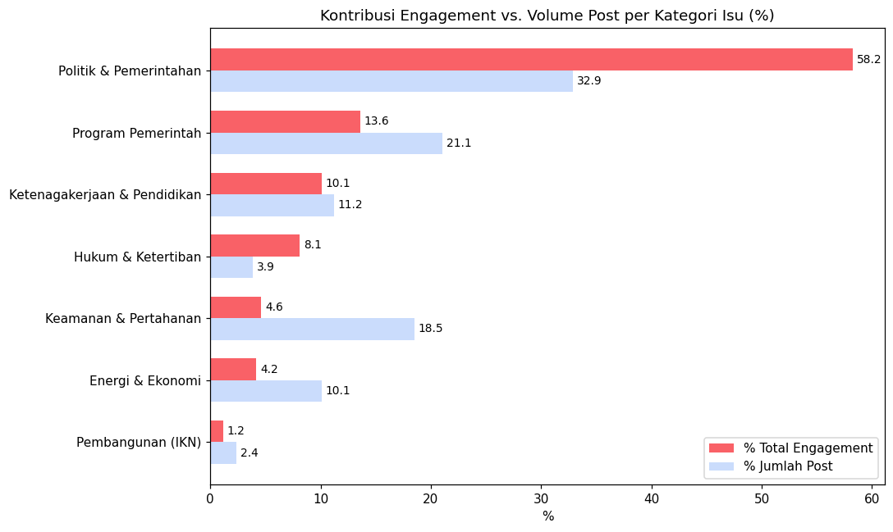
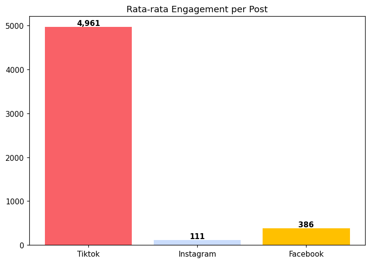
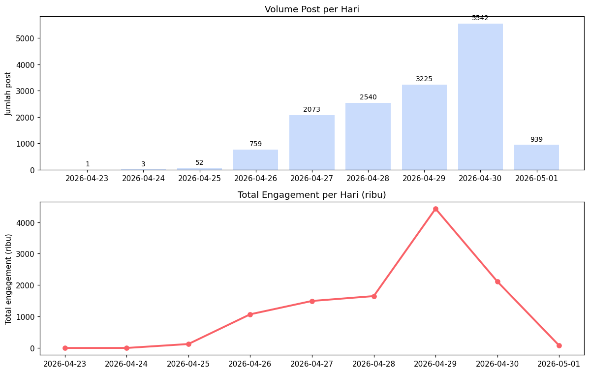
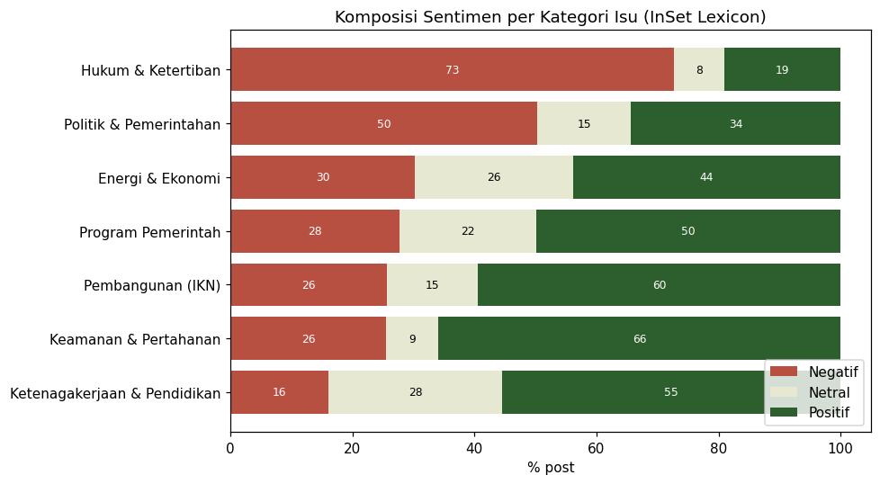

# Social Media Monitoring: Indonesian Government Issues

Exploratory analysis of **15,134 Instagram, Facebook and TikTok posts** about Indonesian government issues (23 April - 1 May 2026): engagement analytics, spam detection, and lexicon-based sentiment analysis in Python.

[](https://colab.research.google.com/github/alesandroyoel/social-media-monitoring-gov-issues/blob/main/notebooks/social_media_monitoring_analysis.ipynb)

> The notebook narration is in Bahasa Indonesia. This README is in English.

## Business problem

The raw monitoring data had every classification column (sentiment, topic, issue class, region) empty. The question this project answers:

> Which issues draw the most public attention, and what is the sentiment weight of each issue?

Analytical questions:
1. Which issue generates the highest engagement?
2. Which platform generates the highest engagement?
3. How did engagement trend between 23 April and 1 May 2026?
4. What is the public sentiment for each issue?

The goal is to help a public communication or monitoring team prioritise issues and respond in a targeted way.

## Dataset

| Item | Detail |
|---|---|
| Rows / columns | 15,134 posts / 28 columns (sheet `Posts`) |
| Platforms | Instagram (69.9%), Facebook (18.5%), TikTok (11.6%) |
| Keywords | 35 unique keywords after normalisation (54 raw spellings), e.g. *prabowo, tni, polri, mbg, guru, korupsi, impeachment, ikn* |
| Period | 23 April - 1 May 2026 |
| Metrics | likes, comments, shares, views, reach, caption text, timestamp, account name |

The raw data and lexicons are **not included**. See [`data/README.md`](data/README.md).

## Approach

1. **Data cleaning.** Dropped 11 columns that were 100% empty, filled missing likes with 0, normalised keywords (`#BBM` = `BBM`), and checked duplicates.
2. **Feature engineering.** `total_engagement = likes + comments + shares`, and grouped the 35 keywords into 7 thematic categories by context and similarity of the issue (a subjective choice, see limitations). View-based engagement was avoided because Instagram view data is missing.
3. **Exploratory analysis.** Issue category, platform, daily trend, top keywords, top accounts.
4. **Text analysis.** Word frequency per category, then sentiment with the InSet weighted lexicon (slang normalisation and stopword removal before scoring). A post scores positive above 0, negative below 0, and neutral at 0.

## Key findings

**1. Politics and government dominate the conversation.** The *Politik & Pemerintahan* category is 32.9% of posts but 58.2% of all engagement.



**2. TikTok: small volume, large impact.** TikTok is 11.6% of posts but 79.4% of engagement. Average engagement per post is 4,961 on TikTok, versus 386 on Facebook and 111 on Instagram (about 13x and 45x lower).



**3. Engagement peaked on 29 April 2026.** Engagement peaked on 29 April (about 4.4M) and post volume peaked on 30 April (5,542 posts). The 29 April surge is spread across several keywords rather than one viral post: *prabowo* 21%, *guru* 15%, *impeachment* 14%, *no king* 12%, *politik* 11% of that day's engagement. This breakdown comes from [`scripts/spike_keyword_breakdown.py`](scripts/spike_keyword_breakdown.py), not from the notebook.



**4. Spam hides inside the TNI/polri keywords.** Word frequency in the *Keamanan & Pertahanan* category was dominated by words like *suka, promo, bebas, beli, pilih*. Tracing it back to the captions showed shops selling jerseys and apparel using the hashtags. **1,006 of 2,800 posts (35.9%)** with these keywords are promotional, with an average engagement of 0.68 versus 282.4 for genuine posts. This likely explains part of why the category's average engagement looks low.

**5. Sentiment is most negative for law and order.** Overall, 46.8% of posts score positive, 35.4% negative and 17.8% neutral. *Hukum & Ketertiban* (keywords *korupsi* and *air keras*) is the most negative at 72.7%, far above *Politik & Pemerintahan* (50.3%) and every other category (31% or less).



## Conclusions and recommendations

- **Prioritise monitoring of Politik & Pemerintahan issues.** Build a priority watchlist for politics and government keywords.
- **Focus public communication and clarification narratives on TikTok.** Short explainer videos that are visual and educational fit the platform, which delivers about 13x the engagement per post of Facebook and 45x that of Instagram.

## Data quality notes and limitations

- **Instagram views and reach are missing.** `jumlah_view` is 0 for 99.8% of Instagram posts, and the summed Instagram `jumlah_reach` is only 370 (versus millions on TikTok and Facebook). Platform comparison therefore uses engagement only, and the reach-based top-accounts table reflects only TikTok and Facebook.
- **Duplicate links.** 840 `parent_link` values repeat, because one post can match several keywords. They are kept for per-issue analysis, so overall totals can double count some posts.
- **Sentiment is an estimate.** It is lexicon-based, with no negation or sarcasm handling, and was not validated against manually labelled data. InSet also assigns weights to function words, so stopwords are removed before scoring.
- **Spam can affect sentiment.** Since 35.9% of TNI/polri posts are promotional, the sentiment shown for *Keamanan & Pertahanan* should be read with care. The notebook does not recompute sentiment without those posts.
- **Topic grouping is subjective.** The 7 categories are my own grouping of the keywords.
- **Spam detection is a simple heuristic.** It matches the words *combat, dryfit, jersey*, so it can miss other promotional posts.
- **Some keywords capture foreign content.** For example, `no king` is dominated by international media accounts, so its high engagement does not reflect Indonesian discussion. Some captions are also in English, which adds noise to the word counts.
- **Short window.** The data covers 9 days, so these results are a snapshot rather than a long-term pattern.

## Repository structure

```
.
├── notebooks/
│   └── social_media_monitoring_analysis.ipynb   # full analysis with outputs
├── scripts/
│   └── spike_keyword_breakdown.py               # keyword breakdown of the 29 April spike
├── images/                                      # charts used in this README
├── data/
│   └── README.md                                # data files are not versioned
├── requirements.txt
└── README.md
```

## How to run

The notebook is written for Google Colab: use the badge above, upload the five data files to the runtime (see [`data/README.md`](data/README.md)), and run all cells.

For a local run:

```bash
git clone https://github.com/alesandroyoel/social-media-monitoring-gov-issues.git
cd social-media-monitoring-gov-issues
pip install -r requirements.txt
# put the five data files in one folder and change FILE_NAME in the notebook's setup cell
jupyter notebook notebooks/social_media_monitoring_analysis.ipynb
```

To reproduce the 29 April keyword breakdown:

```bash
python scripts/spike_keyword_breakdown.py "path/to/Data Test_Assigment Tahap 1.xlsx"
```

## Tech stack

Python, pandas, NumPy, Matplotlib, Jupyter.

## Acknowledgements

Sentiment scoring uses the **InSet** lexicon:

> Koto, F., & Rahmaningtyas, G. Y. (2017). InSet Lexicon: Evaluation of a Word List for Indonesian Sentiment Analysis in Microblogs. *2017 International Conference on Asian Language Processing (IALP)*.

## Author

**Alesandro Yoel Deca Putranto**: Business Statistics, Institut Teknologi Sepuluh Nopember (ITS)
[LinkedIn](https://www.linkedin.com/in/alesandro-yoel) | [GitHub](https://github.com/alesandroyoel)
